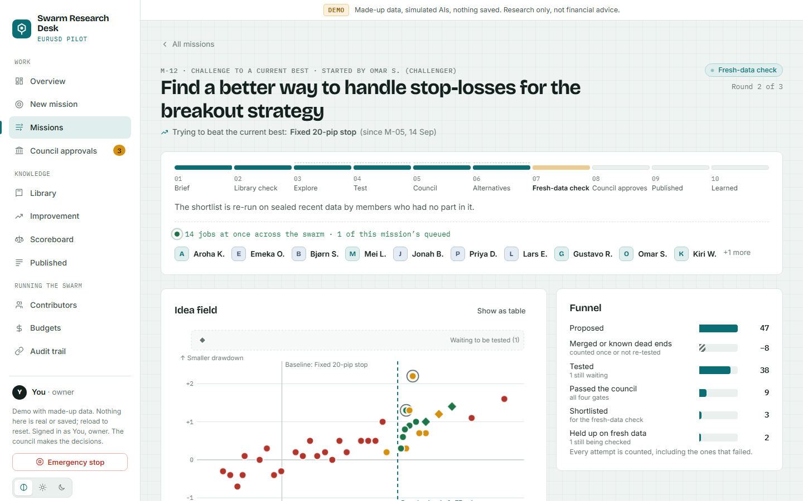

# Swarm Research Desk

**A working demo of the Market Research Swarm EURUSD pilot.**

**Live demo:** https://pepperpete24.github.io/theswarm/

The Market Research Swarm is a research club in which each member lends their own computer and
AI assistant (Claude or Codex) to a shared pool. The pilot studies one market only: the
euro–US dollar exchange rate (EURUSD). A question is handed to one member’s AI, which researches
it and hands in a finding with a signed **run receipt**. A **different** member’s AI redoes the
work on its own. If the two answers agree, an editor AI writes a short post, and a **person**
approves or rejects it. No AI can publish. Every step is written to an **audit trail** in which
each entry carries a fingerprint of the one before it, so a change to an old entry can be
detected. That is all the nickname “the blockchain of algorithms” means: two independent AI
checks, a human sign-off, and a record that can’t be changed quietly.



> ### This is a demo
>
> - All data is made up: members, devices, prices, findings and costs.
> - There is no backend, no real AI and no real market data. Everything runs in your browser.
> - Nothing is saved. Reloading the page resets it.
> - **Research only, not financial advice.** Nothing here is a trading signal.

## Quick start

You need Node 20 or later.

```bash
npm install      # install dependencies
npm run dev      # start the app at http://localhost:5173
npm test         # run the unit and screen tests
npm run build    # build static files into dist/
npm run lint     # check the code style
```

To present the demo, follow [`docs/walkthrough.md`](docs/walkthrough.md), or click
**Take the tour** on the Overview.

## How the job flow works

1. **Asked:** someone asks a research question about EURUSD.
2. **Checked:** the platform checks it hasn’t been answered already and that the budget allows it.
3. **Assigned:** one member’s AI gets the job. The most it may cost is set aside, and it gets a
   60-second lease.
4. **Researching:** the member’s AI does the research, checking in every 15 seconds.
5. **Handed in:** it hands in a finding with a signed run receipt.
6. **Re-checked:** a different member’s AI redoes the work on its own.
7. **Agreed:** if the two answers are at least 90% alike, the finding counts. If not, it is
   challenged and goes back to step 3 with a different member.
8. **Drafted:** an editor AI writes a short, plain post. It can only write drafts.
9. **Person decides:** a person approves or rejects it.
10. **Published:** approved posts appear on the viewer page with their evidence and an expiry.

## What’s in the demo

| Screen | What it shows |
|---|---|
| Overview | Headline numbers, a 24-hour EURUSD chart, what needs attention, the 10 steps |
| Ask a question | The form, the “already studied” and budget checks, and the live simulation |
| Work board | Every job in five columns, from waiting to done |
| Job page | Step bar, the two answers side by side, history, cost and run receipt |
| Review desk | Approve or reject findings that both AIs agree on |
| Published findings | What viewers see, including expired and withdrawn posts |
| Budgets | Today’s spend, spend by member and AI model, the last 7 days |
| Contributors | Members, their limits and track record; pause or resume them |
| Audit trail | The hash-linked record, with a live “try to tamper with it” demo |

## Folder structure

```
.github/workflows/deploy.yml   Builds and publishes to GitHub Pages on every push to main
docs/walkthrough.md            Click-by-click script for presenting the demo
public/                        Static files (favicon)
src/
  data/        Mock data and constants: members, jobs, audit trail, prices, answers
  domain/      Plain logic with no React: budget, dedupe, agreement, audit chain,
               run receipts, the simulator's step plan, status labels
  store/       One Zustand store that wires the logic to the screens and runs the simulation
  components/  Shared pieces: rail, pills, step bar, two-answer view, charts, tour, toasts
  screens/     One file per screen
  styles/      tokens.css (colours, fonts, light and dark) and global.css
  test/        Vitest tests for the logic, the store and the screens
BUILD-BRIEF.md                 The current build brief (v2, council swarm)
```

## Changing the mock data

Everything the demo shows lives in `src/data/`:

- **`constants.ts`**: the limits and timings. Daily swarm limit (`DAILY_SWARM_CAP`, $25),
  member limit (`MEMBER_DAILY_CAP`, $5), agreement bar (`AGREEMENT_BAR`, 90%), max active jobs,
  lease and check-in times, the simulation speed (`TICK_MS`, 2.3 s), step names, roles and the
  example questions.
- **`members.ts`**: the eight contributors.
- **`jobs.ts`**: the nine starting jobs, one in each state, with their answers and history.
- **`audit.ts`**: the 17 starting audit entries. Entry 8 is the one the tamper demo changes.
- **`prices.ts`**: the seeded random walk of EURUSD prices, the same on every load.
- **`answers.ts`**: the made-up answers the simulated AIs give to new questions.

The audit fingerprints are real SHA-256 hashes, worked out in the browser when the page loads.

## Deploying to GitHub Pages

The workflow in `.github/workflows/deploy.yml` lints, tests and builds the app, then publishes
`dist/` to GitHub Pages on every push to `main`.

**One-time setup:** in the repository go to **Settings → Pages → Build and deployment →
Source** and choose **GitHub Actions**. The next push to `main` (or a manual run of the
workflow from the **Actions** tab) publishes the site at
`https://<user>.github.io/<repo>/`.

The app uses hash links (`#/jobs/J-1043`) and relative asset paths (`base: './'` in
`vite.config.ts`), so it works from any sub-path with no server set-up.

## Assumptions

These are placeholders to confirm with the project owner.

1. Pilot numbers come from the plan: 5–10 contributors (the demo shows 8), max 20 active jobs,
   60 s lease, 15 s check-in.
2. **$25/day swarm budget and $5/day per member** are invented placeholders.
3. **The 90% agreement bar** is invented; the source material doesn’t define how close a
   re-check must be.
4. There is one human publisher (“You”); the named research lead and reviewer are still open.
5. Viewers are read-only; nothing is a trading signal or advice.
6. AI names (Claude, Codex) follow the source material; the model names are examples.
7. “Blockchain” is shown only as the hash-linked audit trail. There is no real chain or token.
8. Outside AIs can also ask questions in the real design; the demo shows the human form only.

**Open questions:** Should viewers see contributor names or stay anonymous? Should viewers be
able to challenge a finding? Is US$ the right currency?

## Out of scope

Real sign-in, a real backend or database, real AI calls, real market data, payments, trading
or placing orders, and any blockchain, token or wallet.

## Contributing

1. Create a branch from `main`.
2. Make your change. Keep on-screen words plain and friendly (see section 9 of
   `BUILD-BRIEF.md`).
3. Run `npm run lint`, `npm test` and `npm run build` before you push. All three must pass.
4. Open a pull request against `main`. Merging it deploys the demo.

## Licence

Apache License 2.0. See [`LICENSE`](LICENSE).
